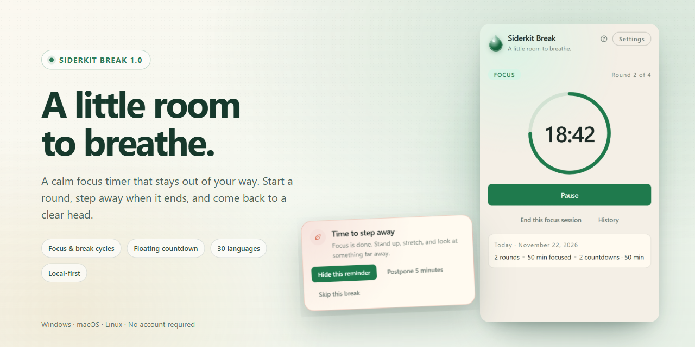
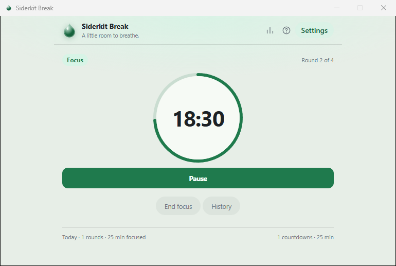
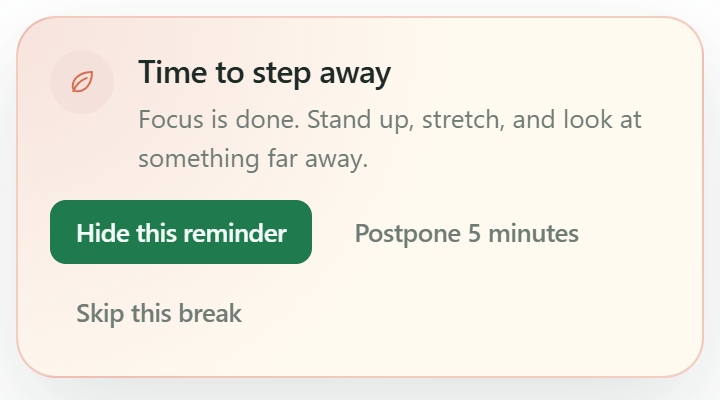
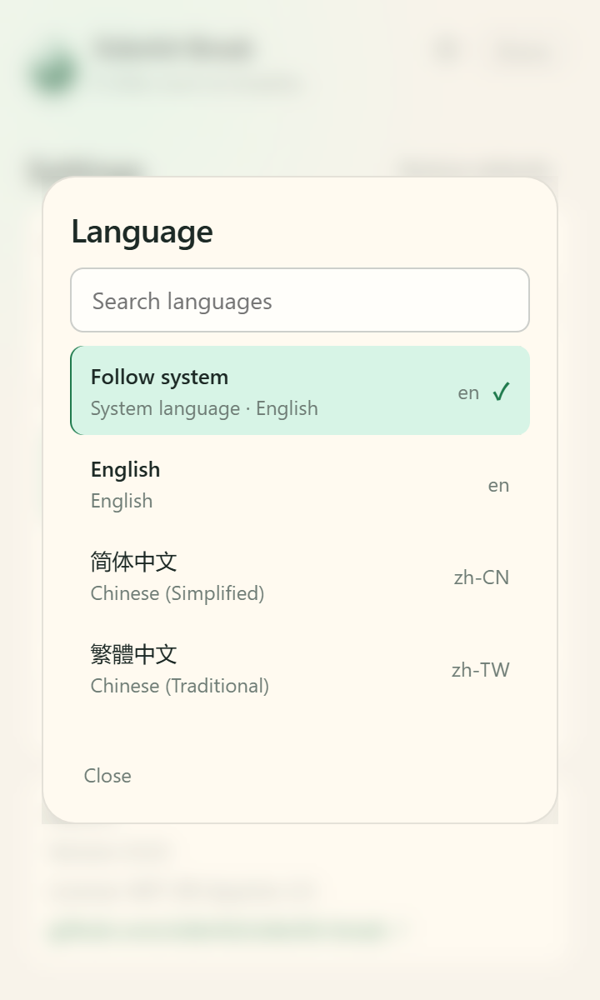

<div align="center">
  
</div>

# Siderkit Break

**A little room to breathe.**

A calm, local-first focus timer for Windows, macOS, and Linux. It keeps a quiet focus rhythm, stays out of your way, and reminds you to stand up and look away.

**Languages:** English · [简体中文](docs/i18n/zh-CN/README.md) · [繁體中文](docs/i18n/zh-TW/README.md) · [हिन्दी](docs/i18n/hi/README.md) · [Español](docs/i18n/es/README.md) · [Français](docs/i18n/fr/README.md) · [Português](docs/i18n/pt/README.md) · [العربية](docs/i18n/ar/README.md) · [বাংলা](docs/i18n/bn/README.md) · [Bahasa Indonesia](docs/i18n/id/README.md) · [Русский](docs/i18n/ru/README.md) · [اردو](docs/i18n/ur/README.md) · [Deutsch](docs/i18n/de/README.md) · [日本語](docs/i18n/ja/README.md) · [Kiswahili](docs/i18n/sw/README.md) · [मराठी](docs/i18n/mr/README.md) · [తెలుగు](docs/i18n/te/README.md) · [Türkçe](docs/i18n/tr/README.md) · [தமிழ்](docs/i18n/ta/README.md) · [Tiếng Việt](docs/i18n/vi/README.md) · [한국어](docs/i18n/ko/README.md) · [فارسی](docs/i18n/fa/README.md) · [Filipino](docs/i18n/fil/README.md) · [ไทย](docs/i18n/th/README.md) · [Italiano](docs/i18n/it/README.md) · [Bahasa Melayu](docs/i18n/ms/README.md) · [Polski](docs/i18n/pl/README.md) · [Українська](docs/i18n/uk/README.md) · [Nederlands](docs/i18n/nl/README.md) · [Română](docs/i18n/ro/README.md)

> **Status:** 1.0 release candidate. Windows and Linux artifacts are built and verified on test machines; the macOS build is unsigned. No public binaries have been published yet. [Build from source](#build-from-source) to try it now.

Siderkit Break is an experimental project from Siderkit. The 1.0 release is intentionally small: a local-first focus timer with a tray presence, a transparent floating countdown, and in-app reminder cards. It needs no account and no server for your data. On Windows it can check for updates; anonymous install counts are optional and can be turned off.

## At a glance

|                    |                                                                                                       |
| ------------------ | ----------------------------------------------------------------------------------------------------- |
| **Focus rhythm**   | 25-minute focus, 5-minute short break, 15-minute long break every 4 rounds. Every length is editable. |
| **Floating timer** | A small always-on-top countdown that stays click-through until you point at it.                       |
| **Reminders**      | In-app cards at every phase boundary, with postpone, skip, and a built-in chime.                      |
| **History**        | Every session stored locally in SQLite, with a styled spreadsheet (`.xlsx`) export.                   |
| **Languages**      | 40 UI languages, system-language detection, and true right-to-left layouts.                           |
| **Your data**      | Local only. No account, no sync; optional anonymous install counts.                                   |

## A closer look

| Focus timer                                                                                                    | Break reminder                                                                                                                         | Settings and languages                                                                                                                |
| -------------------------------------------------------------------------------------------------------------- | -------------------------------------------------------------------------------------------------------------------------------------- | ------------------------------------------------------------------------------------------------------------------------------------- |
|  |  |  |

The screenshots are captured from the running app. The break card is a native window with a transparent background.

## What it does

- **A rhythm that fits.** Run focus, short break, and long break cycles with pause, resume, skip, and reset. The default 25/5/15 rhythm follows the classic focus technique; every length and the long-break interval can be changed.
- **Out of your way.** The floating countdown stays on top, labels break phases, and ignores clicks until you point at it. The tray menu can start a phase, show or hide the ball, locate it on screen, or open the main window.
- **Reminders you can act on.** Every phase boundary opens a small card with the next action. Start the break, postpone it for five minutes, skip it, or close the card. Reminders and the built-in chime can be turned off independently.
- **A record that stays yours.** Completed, skipped, reset, and interrupted sessions are stored locally. Review them by day or export a formatted spreadsheet with summary, daily, and session sheets.
- **Updates without the busywork.** On Windows the app checks for signed updates in the background, downloads only when you ask, and installs on restart. macOS and Linux builds are downloaded manually.
- **Yours in your language.** Choose from 40 languages or follow the system language. Arabic, Persian, and Urdu switch the whole layout to right-to-left. Light, dark, and system themes come with twelve color styles that repaint the whole window.
- **Small conveniences.** Global shortcuts, launch at login, start minimized, and close-to-tray.

## What it does not do

- No todo lists, notes, or project management.
- No accounts, sync, teams, or cloud services. The only network requests are update checks and the optional anonymous install beacon.
- No mobile apps or home-screen widgets.
- No plugins, AI features, or task management.
- No true in-taskbar text embedding; the floating countdown is a separate always-on-top window.

## Platform support

| Platform                                   | Minimum                                 | Artifacts          | Status                                                 |
| ------------------------------------------ | --------------------------------------- | ------------------ | ------------------------------------------------------ |
| Windows 10 / 11 x64                        | Windows 10 1809 (build 17763)           | NSIS installer     | Windows 10 22H2 VM verified; Windows 11 built locally  |
| macOS Intel                                | macOS 10.15.7 with Safari 15.4 or newer | Universal DMG      | CI build; signing pending                              |
| macOS Apple Silicon                        | macOS 11.0                              | Universal DMG      | CI build; signing pending                              |
| Ubuntu 22.04+ and compatible distributions | webkit2gtk 4.1, X11                     | deb, rpm, AppImage | Ubuntu 22.04.5 X11 VM verified; Wayland is best-effort |

Windows 10 1809–21H2 are supported targets but have not been verified on physical hardware. Windows 10 reached end of support in October 2025; the app still runs there, but the operating system no longer receives updates.

Linux notes: the floating countdown needs a compositor that lets the app position a top-level window. Wayland does not provide that capability, so positioning, click-through, and global shortcuts may not work. Use an X11 session for the full experience. GNOME also needs an AppIndicator extension for the tray icon.

## Build from source

Prerequisites: Node.js 22 or newer, pnpm 12, a Rust toolchain, and the platform build tools required by the desktop framework.

```bash
pnpm install
pnpm check
```

Build the installers for the current platform:

```bash
pnpm tauri build
```

Or choose the bundle formats explicitly:

```bash
# Windows: NSIS (per-user)
pnpm tauri build --bundles nsis

# macOS: one universal DMG
pnpm tauri build --target universal-apple-darwin --bundles dmg

# Linux: deb, rpm, and AppImage
pnpm tauri build --bundles deb,rpm,appimage
```

The output lands in `src-tauri/target/release/bundle/`. CI builds every platform on demand without publishing a release. See [docs/release.md](docs/release.md) for signing, verification, and the release checklist.

## Development

```bash
pnpm install
pnpm tauri dev
pnpm check
```

`pnpm check` runs formatting, the web checks, and the Rust checks. If the Rust toolchain is not installed, run `pnpm check:web` for the UI, type, CSS, dependency, duplication, and file-size gates.

## Design principles

- **Local-first by default.** The database lives on your machine. There is no account system and no network path for your session data. Update checks and optional anonymous counts are the only outbound requests.
- **The timer belongs to the core.** Rust owns time and state; the UI only renders and sends commands. The timer stays accurate when the window is hidden or the system is busy.
- **Calm, not demanding.** No streaks, badges, guilt, or engagement loops. The app asks for a few minutes and then gets out of the way.
- **One job, done well.** A focus timer should not grow into a task manager. The small surface is a feature.
- **Keyboard-friendly.** Global shortcuts, visible focus states, and reduced-motion support are part of the baseline.

## Documentation

- [Product brief](docs/product-brief.md)
- [Core flows](docs/core-flows.md)
- [Acceptance criteria](docs/acceptance.md)
- [Technical design](docs/tech-design.md)
- [Release guide](docs/release.md)
- [Privacy](PRIVACY.md)
- [Code quality](docs/code-quality.md)
- [ADR-0001: stack](docs/adr/0001-stack.md)
- [ADR-0002: taskbar and overlay](docs/adr/0002-taskbar-overlay.md)
- [ADR-0003: bundled reminder sound](docs/adr/0003-reminder-sound.md)
- [ADR-0004: in-app reminders](docs/adr/0004-in-app-reminders.md)

## Contributing

Bug reports, translations, and focused pull requests are welcome. Read [CONTRIBUTING.md](CONTRIBUTING.md) before opening an issue or a pull request. Please report security issues privately as described in [SECURITY.md](SECURITY.md).

## License

GPL-3.0-only. See [LICENSE](LICENSE) and [NOTICE](NOTICE). Releases up to `1.0.3` remain under Apache-2.0.
