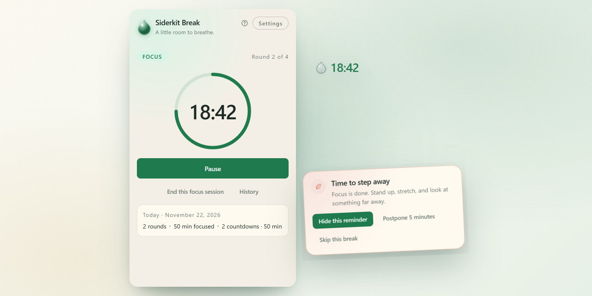

<div align="center">
  
</div>

# Siderkit Break

**Trochę miejsca na oddech.**

Spokojny, lokalny timer skupienia dla Windows, macOS i Linux. Utrzymuje rytm, nie przeszkadza i przypomina, żeby wstać i spojrzeć w dal.

**Języki:** [English](../../../README.md) · [简体中文](../zh-CN/README.md) · [繁體中文](../zh-TW/README.md) · [हिन्दी](../hi/README.md) · [Español](../es/README.md) · [Français](../fr/README.md) · [Português](../pt/README.md) · [العربية](../ar/README.md) · [বাংলা](../bn/README.md) · [Bahasa Indonesia](../id/README.md) · [Русский](../ru/README.md) · [اردو](../ur/README.md) · [Deutsch](../de/README.md) · [日本語](../ja/README.md) · [Kiswahili](../sw/README.md) · [मराठी](../mr/README.md) · [తెలుగు](../te/README.md) · [Türkçe](../tr/README.md) · [தமிழ்](../ta/README.md) · [Tiếng Việt](../vi/README.md) · [한국어](../ko/README.md) · [فارسی](../fa/README.md) · [Filipino](../fil/README.md) · [ไทย](../th/README.md) · [Italiano](../it/README.md) · [Bahasa Melayu](../ms/README.md) · **Polski** · [Українська](../uk/README.md) · [Nederlands](../nl/README.md) · [Română](../ro/README.md)

> **Status:** Wersja kandydująca 1.0. Brak publicznych plików binarnych; zbuduj ze źródeł.

## Najważniejsze funkcje

- **Rytm dopasowany do Ciebie.** Cykle skupienia, krótkiej i długiej przerwy z pauzą, wznowieniem, pominięciem i resetem.
- **Nie przeszkadza.** Mały licznik zawsze na wierzchu, który przepuszcza kliknięcia, dopóki na niego nie wskażesz.
- **Przypomnienia z działaniem.** Karty w aplikacji na końcu każdego etapu, z odroczeniem, pominięciem i wbudowanym dźwiękiem.
- **Dane zostają u Ciebie.** Lokalna historia sesji, eksport do arkusza, 30 języków, motywy i globalne skróty.

## Zbuduj ze źródeł

Wymagane są Node.js 22+, pnpm 12, narzędzia Rust i narzędzia kompilacji platformy wymagane przez framework desktopowy.

```bash
pnpm install
pnpm check
pnpm tauri build
```

Pełna macierz platform i polecenia pakowania znajdują się w angielskim README.

## Dokumentacja

- [Przegląd produktu](../../product-brief.md)
- [Przewodnik wydania](../../release.md)
- [English README](../../../README.md)
- [Wszystkie języki](../README.md)

## Licencja

MIT OR Apache-2.0. See [LICENSE](../../../LICENSE), [LICENSE-MIT](../../../LICENSE-MIT), and [LICENSE-APACHE](../../../LICENSE-APACHE).
